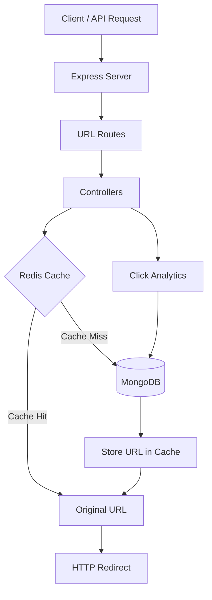

# ⚡ URL Shortener

### A fast, scalable URL Shortener API built with Node.js, Express, MongoDB & Redis.

Transform long URLs into short, shareable links with **Base62 encoding, Redis caching, click analytics, and automatic URL expiration**.

<p align="center">
  <a href="https://url-shortener-w6rn.onrender.com">
    
  </a>
  
  
  
  
</p>

<p align="center">
  <a href="https://url-shortener-w6rn.onrender.com/health">Health Check</a> ·
  <a href="#-features">Features</a> ·
  <a href="#-api-reference">API Reference</a> ·
  <a href="#-getting-started">Getting Started</a>
</p>

---

## 🌐 Live Demo

**Base URL:** [https://url-shortener-w6rn.onrender.com](https://url-shortener-w6rn.onrender.com)

| Endpoint | Description |
|---|---|
| [`GET /health`](https://url-shortener-w6rn.onrender.com/health) | Check server health |
| `POST /api/v1/urls` | Create a short URL |
| `GET /:shortCode` | Redirect to the original URL |
| `GET /api/v1/urls/:shortCode/analytics` | Retrieve click analytics |

> **Note:** The API is live. Use the POST endpoint to create a short URL before testing its redirect or analytics endpoints.

## ✨ Features

- 🔗 **URL Shortening** — Convert long URLs into compact, shareable links.
- 🔢 **Base62 Encoding** — Generate short codes using a custom encoding utility and a MongoDB counter.
- ⚡ **Redis Caching** — Cache URL lookups to reduce repeated database reads.
- 📊 **Click Analytics** — Track redirect counts for each short URL.
- ⏳ **URL Expiration** — Set an optional expiration date for short links.
- 🛡️ **Input Validation** — Validate submitted URLs and expiration dates.
- 🚦 **Rate Limiting** — Limit URL creation requests to help prevent abuse.
- 💾 **Persistent Storage** — Store URL records and analytics in MongoDB.
- ☁️ **Cloud Deployment** — Deploy the Express backend with hosted database services.

## 🛠️ Tech Stack

| Technology | Role |
|---|---|
| **Node.js** | JavaScript runtime |
| **Express.js** | HTTP server, REST API and redirects |
| **MongoDB** | URL records, counters and analytics |
| **Mongoose** | MongoDB object modeling |
| **Redis** | URL lookup caching |
| **Docker** | Local database and cache services |
| **Render** | Backend hosting |

## 🏗️ Architecture



### Redirect Flow

1. A client requests a short URL.
2. The backend checks Redis for the corresponding original URL.
3. On a cache miss, MongoDB is queried.
4. The URL lookup result is cached with a limited lifetime.
5. The backend records the redirect count and redirects the client.

## 🚀 API Reference

### 1. Create a Short URL

Creates a short URL for a valid HTTP or HTTPS address.

**Request**

```http
POST /api/v1/urls
Content-Type: application/json
```

**Body**

```json
{
  "originalUrl": "https://example.com"
}
```

Optional expiration:

```json
{
  "originalUrl": "https://example.com",
  "expiresAt": "2027-01-01T00:00:00.000Z"
}
```

**Response — `201 Created`**

```json
{
  "success": true,
  "shortCode": "2",
  "shortUrl": "https://url-shortener-w6rn.onrender.com/2",
  "expiresAt": null
}
```

**Possible status codes**

| Code | Meaning |
|---|---|
| `201` | Short URL created |
| `400` | Invalid URL or expiration date |
| `429` | Rate limit exceeded |
| `500` | Unexpected server error |

### 2. Redirect to the Original URL

**Request**

```http
GET /:shortCode
```

**Example**

```http
GET /2
```

The server responds with an HTTP redirect to the original URL.

| Code | Meaning |
|---|---|
| `302` | Redirect successful |
| `404` | Short URL not found |
| `410` | Short URL expired |

### 3. Retrieve URL Analytics

**Request**

```http
GET /api/v1/urls/:shortCode/analytics
```

**Example**

```http
GET /api/v1/urls/2/analytics
```

**Response — `200 OK`**

```json
{
  "success": true,
  "analytics": {
    "_id": "example-id",
    "originalUrl": "https://example.com",
    "shortCode": "2",
    "expiresAt": null,
    "clickCount": 2,
    "createdAt": "2026-10-12T11:39:40.461Z"
  }
}
```

The `_id`, timestamps, and click count are illustrative; actual values depend on the stored URL record and redirects.

## 💻 Getting Started

### Prerequisites

- [Node.js](https://nodejs.org/) and npm
- [Docker Desktop](https://www.docker.com/products/docker-desktop/)
- Git

### 1. Clone the repository

```bash
git clone <YOUR_GITHUB_REPOSITORY_URL>
cd url-shortener
```

Replace the placeholder with your actual GitHub repository URL.

### 2. Install dependencies

```bash
npm install
```

### 3. Start MongoDB and Redis with Docker

If your containers already exist, start them:

```bash
docker start mongodb redis
```

Otherwise, create the containers:

```bash
docker run -d \
  --name mongodb \
  -p 27017:27017 \
  mongo:7
```

```bash
docker run -d \
  --name redis \
  -p 6379:6379 \
  redis:latest
```

### 4. Configure environment variables

Create a `.env` file in the project root:

```env
PORT=5001
BASE_URL=http://localhost:5001
MONGODB_URI=mongodb://127.0.0.1:27017/url-shortener
REDIS_URL=redis://127.0.0.1:6379
```

These are local development values. For production, configure the corresponding environment variables in Render with your MongoDB Atlas connection string, hosted Redis URL, and public service URL.

**Never commit `.env` or expose database credentials.**

### 5. Run the server

Development:

```bash
npm run dev
```

Production-style local start:

```bash
npm start
```

Local API:

```text
http://localhost:5001
```

### 6. Create your first short URL

```bash
curl -X POST http://localhost:5001/api/v1/urls \
  -H "Content-Type: application/json" \
  -d '{"originalUrl":"https://example.com"}'
```

Copy the returned `shortUrl` and open it in a browser to test the redirect.

## 🔐 Environment Variables

| Variable | Description |
|---|---|
| `PORT` | Express server port |
| `BASE_URL` | Public base URL used to construct short links |
| `MONGODB_URI` | MongoDB connection string |
| `REDIS_URL` | Redis connection URL |

Keep separate local and production configuration. Render should use its own environment variables rather than attempting to access your Mac's Docker services.

## 🧠 Engineering Highlights

This project demonstrates practical backend engineering concepts:

- **Encoding:** Base62 conversion for compact identifiers.
- **Database design:** MongoDB models, unique short-code lookups, and counter-based code generation.
- **Caching:** Redis-backed URL lookups with expiration.
- **Analytics:** Persistent click-count updates.
- **API reliability:** Input validation and rate limiting.
- **Deployment:** Production environment configuration and cloud hosting.

## 👨‍💻 Author

**Mayank Mittal**

Backend-focused developer interested in Node.js, Express, MongoDB, Redis, Docker, and backend system design.

---

<p align="center">
  <b>Built to learn and demonstrate practical backend engineering.</b>
</p>
